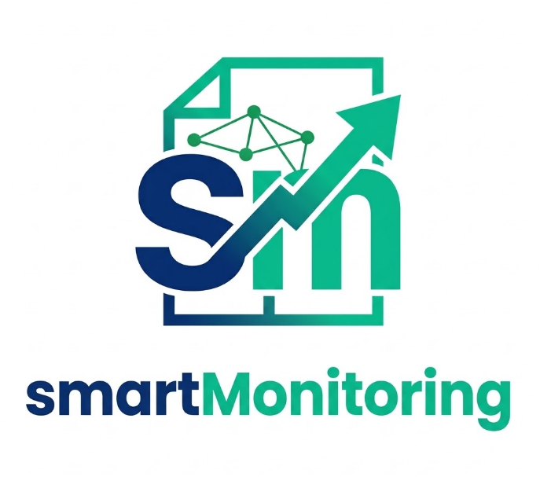

# smartMonitoring · Bitget 合约自动交易机器人



自动在 Bitget USDT 永续合约（默认 BTC、ETH）上实时进场、出场，重点是**控制亏损**。

> ⚠️ 没有任何程序能保证赚钱或不亏钱。100 倍杠杆下价格反向约 0.5% 就会爆仓。
> 请按顺序：回测 → 本地模拟 → Bitget 模拟盘，结果满意后再自己决定是否用真钱。

---

## 1. 它怎么交易

| 项目 | 规则 |
|---|---|
| 大方向 | 1 小时 K 线：价格在 EMA50 之上且 EMA50 向上才做多，反过来才做空，方向不明不交易 |
| 进场 | 5 分钟 K 线收盘突破前 20 根的最高点（做多）/ 最低点（做空），并且成交量大于平均 1.2 倍 |
| 仓位 | 每单保证金 5–15 USDT，信号越强开越多，100 倍逐仓 |
| 止损 | 1 倍 ATR，限制在 0.15%–0.40% 之间；超过 0.40% 说明波动太大，这单不做 |
| 止盈 | 止损距离的 2 倍 |
| 保本 / 跟踪 | 赚到 1 倍止损距离后，止损移到保本；之后用 1.5 倍 ATR 跟踪锁利润 |
| 最长持仓 | 4 小时（48 根 5 分钟 K 线）还没结果就平仓 |

**止损和止盈在开仓时就挂在 Bitget 上**，就算你的电脑断网或程序崩溃，交易所也会帮你止损。

## 2. 风控（减少亏损）

- **每日亏损上限**：当天亏到开始资金的 30% → 立刻全部平仓，当天不再开单（按 UTC+8 00:00 算新的一天）
- **单笔亏损上限**：止损 + 手续费最多亏 10 USDT，超过会自动缩小仓位
- **爆仓保护**：止损价必须比估算爆仓价早至少 0.08%；开仓后再读交易所真实爆仓价，如果止损在爆仓价之后就马上平仓
- **连亏暂停**：连续亏 4 单暂停 2 小时；某个币止损后，这个币要等 30 分钟再开单
- **资金底线**：账户总资金低于 50 USDT，机器人完全停止
- **最多同时 2 单**，只用逐仓

所有数字都在 `config.yaml` 里，有中文说明，可以自己改。

## 3. 安装（Windows）

1. 安装 Python 3.11 以上：https://www.python.org/downloads/ （安装时勾选 "Add Python to PATH"）
2. 把整个 `bitget-futures-bot` 文件夹复制到电脑上，在文件夹里打开 PowerShell
3. 安装依赖：
   ```powershell
   pip install -r requirements.txt
   ```

## 4. 使用步骤

### 第一步：下载历史数据并回测（不需要 API key）
```powershell
python main.py download --days 180
python main.py backtest
```
如果 Bitget 只给了最近一段数据，可以用币安的历史数据回测（价格走势几乎一样）：
```powershell
python main.py download --days 365 --exchange binanceusdm
python main.py backtest --exchange binanceusdm
```
结果会显示收益、胜率、最大回撤、每天亏到 30% 的次数等，每笔交易在 `data/backtest_trades.csv`。

### 第二步：本地模拟（真实行情，不下单，不需要 API key）
把 `config.yaml` 里的 `mode` 改成 `paper`：
```powershell
python main.py run
```

### 第三步：Bitget 模拟盘（假钱）
1. 登录 Bitget → 切换到「模拟交易」→ 在模拟账户里创建 API key（权限选「合约交易」，**不要开提现**）
2. 在 PowerShell 设置环境变量（**不要把 key 写进任何文件，也不要发给别人**）：
   ```powershell
   $env:BITGET_API_KEY="你的key"
   $env:BITGET_API_SECRET="你的secret"
   $env:BITGET_API_PASSPHRASE="你的passphrase"
   ```
3. `config.yaml` 里 `mode: demo`，然后：
   ```powershell
   python main.py run
   ```
建议至少跑 3–5 天，看 `data/bot.log` 里的每一笔开仓、平仓。

### 第四步：真钱（只在你确定之后）
需要真实账户的 API key，`mode: live`，并且额外设置：
```powershell
$env:I_UNDERSTAND_REAL_MONEY="yes"
```
没有这一行，程序拒绝用真钱运行。

### 停止
按 `Ctrl + C`。已经开着的单仍然有交易所上的止损/止盈保护。
重新启动时程序会读取 `data/state.json`，接着管理之前的单，并记得当天已经亏了多少。

## 5. 文件说明

| 文件 | 作用 |
|---|---|
| `config.yaml` | 所有参数 |
| `main.py` | 启动入口 |
| `bot/strategy.py` | 进出场信号 |
| `bot/risk.py` | 风控：仓位、止损、每日亏损上限、爆仓保护 |
| `bot/exchange.py` | Bitget 下单（模拟盘/实盘）和本地模拟 |
| `bot/engine.py` | 实时循环 |
| `bot/backtest.py` | 回测 |
| `tests/` | 自动测试：`python -m pytest tests` |

## 6. 需要知道的限制

- 手续费影响很大：1500 USDT 仓位开平一次约 1.8 USDT，止损又很近，所以策略需要赚得比手续费多才有用。回测已经算进手续费和滑点。
- 回测没有算资金费率（每 8 小时一次，金额通常很小）。
- 模拟盘的成交和真实市场会有差别，尤其是行情剧烈时的滑点。
- 交易所上挂的止损是按标记价格触发的，极端行情可能成交在比止损更差的价格。
